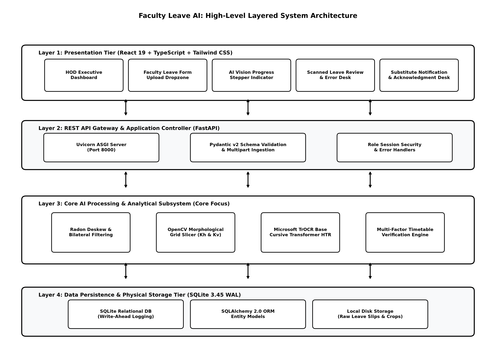
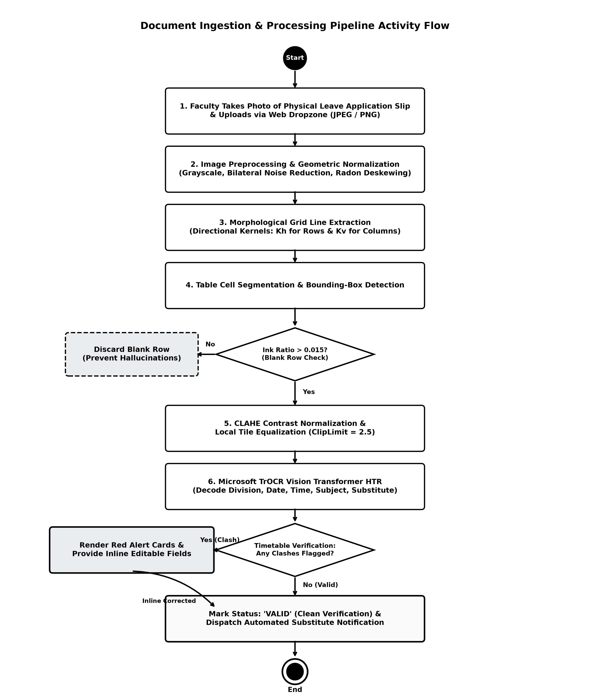
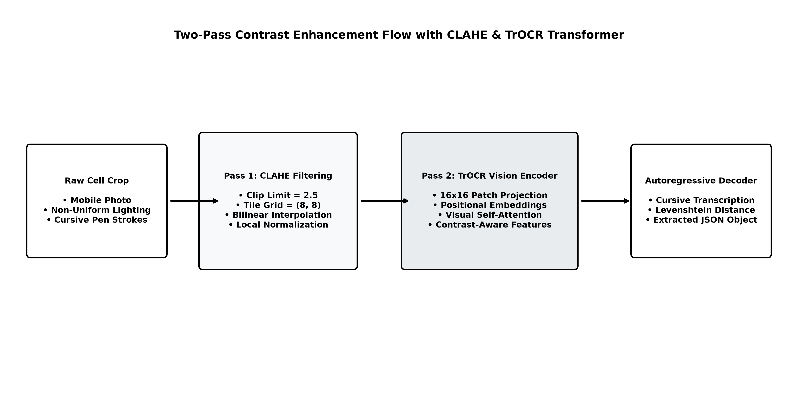
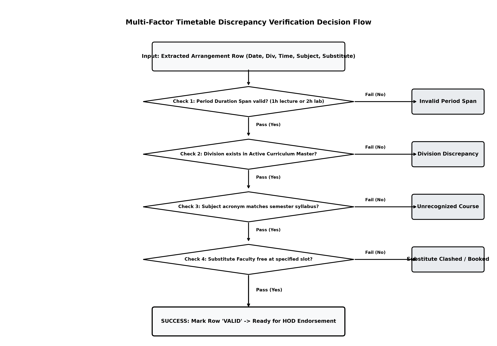

# FACULTY LEAVE AI: AUTOMATED HANDWRITTEN LEAVE ARRANGEMENT AND NOTIFICATION SYSTEM WITH MULTI-FACTOR TIMETABLE VERIFICATION

### (B. Tech. Project–II)

---

## A REPORT

Submitted in partial fulfillment of the requirements for Semester VII of  
**BACHELOR OF TECHNOLOGY**  
**(INFORMATION TECHNOLOGY)**

**Submitted by:**

**Het Patel**  
Roll No.: IT155 | Student ID: 24ITUOS910  
B. Tech. Semester–VII (Information Technology): 2026–27

**Riya Ajit Trivedi**  
Roll No.: IT081 | Student ID: 23ECUOG183  
B. Tech. Semester–VII (Information Technology): 2026–27

**Under the guidance of:**  
**Prof. Dr. Harshadkumar B. Prajapati**  
Professor, Department of Information Technology

**Department of Information Technology**  
**Faculty of Technology**  
**DHARMSINH DESAI UNIVERSITY**  
Nadiad–387001, Gujarat, INDIA  
*October 2026*

---

\newpage

## Candidate Disclosure on the Use of AI Tools

In the process of developing the software prototype and compiling this project report, the authors utilized modern generative AI utilities, computer vision toolchains, and assistive writing software strictly in compliance with Dharmsinh Desai University academic integrity guidelines. The specific tools and their respective roles were as follows:

1. **GitHub Copilot & DeepMind Antigravity Pair-Programming Agent**: Utilized for syntactic code completion, boiler-plate FastAPI route drafting, Playwright automated testing harness generation, and writing unit test cases.
2. **Microsoft TrOCR (`microsoft/trocr-base-handwritten`)**: Deployed as the foundational deep transformer vision-encoder-decoder model for decoding cursive handwriting from cropped cell segments of academic leave sheets.
3. **OpenCV & PyTorch**: Utilized for custom morphological kernel filtering, page deskewing, contour line detection, and inference orchestration.
4. **Grammarly (Academic Edition)**: Utilized to audit technical grammar, verify academic writing tone, eliminate passive-voice inconsistencies, and verify spelling mechanics.
5. **Zotero (Open Source)**: Employed as the bibliographic citation management software to catalog academic literature, IEEE transaction papers, and format reference styles.

All architectural solutions, algorithm formulations, database schema designs, timetable discrepancy logic implementations, and final conclusions were conceived, verified, and benchmarked by the authors.

---

\newpage

## Candidate’s Declaration

We hereby declare that this Semester VII B.Tech. Project–II report, entitled **“FACULTY LEAVE AI: AUTOMATED HANDWRITTEN LEAVE ARRANGEMENT AND NOTIFICATION SYSTEM WITH MULTI-FACTOR TIMETABLE VERIFICATION”**, is our own authentic project work conducted under the guidance and supervision of **Prof. Dr. Harshadkumar B. Prajapati**, Professor, Department of Information Technology, Dharmsinh Desai University, Nadiad.

We further declare that to the best of our knowledge and belief, this report does not contain any part of any work that has been submitted for the award of any degree or diploma either in this University or in any other institution of higher learning without formal academic citation and acknowledgment.

\vspace{1.5cm}

______________________________  
**Het Patel**  
Roll No.: IT155  
Student ID: 24ITUOS910  
B. Tech. Semester–VII (IT)  
Department of Information Technology  
Dharmsinh Desai University, Nadiad  

\vspace{1.0cm}

______________________________  
**Riya Ajit Trivedi**  
Roll No.: IT081  
Student ID: 23ECUOG183  
B. Tech. Semester–VII (IT)  
Department of Information Technology  
Dharmsinh Desai University, Nadiad  

Date: 20th October, 2026  
Place: Nadiad, Gujarat, India  

---

\newpage

## CERTIFICATE

**DHARMSINH DESAI UNIVERSITY**  
**FACULTY OF TECHNOLOGY**  
**DEPARTMENT OF INFORMATION TECHNOLOGY**  
*College Road, Nadiad–387001, Gujarat, INDIA*

\vspace{0.8cm}

This is to certify that the project report entitled **“FACULTY LEAVE AI: AUTOMATED HANDWRITTEN LEAVE ARRANGEMENT AND NOTIFICATION SYSTEM WITH MULTI-FACTOR TIMETABLE VERIFICATION”** submitted for the partial fulfillment of the requirements for the degree of **Bachelor of Technology in Information Technology** (Semester–VII) is a bona fide record of the research and development work carried out by:

\begin{center}
\textbf{Het Patel} (Roll No.: IT155, ID No.: 24ITUOS910) \\
\textbf{Riya Ajit Trivedi} (Roll No.: IT081, ID No.: 23ECUOG183)
\end{center}

during the academic year 2026–2027 in the Department of Information Technology, Faculty of Technology, Dharmsinh Desai University, Nadiad. The project has been examined and approved.

\vspace{2.5cm}

\noindent
\begin{tabular}{@{}p{8cm}p{8cm}@{}}
\textbf{Project Guide:} & \textbf{Head of Department:} \\[1.2cm]
\textbf{Prof. Dr. Harshadkumar B. Prajapati} & \textbf{Prof. Dr. Vipul K. Dabhi} \\
Professor, & Professor \& Head, \\
Department of Information Technology, & Department of Information Technology, \\
Faculty of Technology, & Faculty of Technology, \\
Dharmsinh Desai University, & Dharmsinh Desai University, \\
Nadiad–387001, Gujarat, INDIA & Nadiad–387001, Gujarat, INDIA
\end{tabular}

---

\newpage

## Acknowledgment

We express our deepest sense of gratitude to our respected project guide, **Prof. Dr. Harshadkumar B. Prajapati**, Professor in the Department of Information Technology, Faculty of Technology, Dharmsinh Desai University, for his invaluable supervision, insightful suggestions, constant encouragement, and intellectual guidance throughout the inception, design, and execution of this project. His high standards of scientific rigor, clarity of thought, and constructive feedback played a transformative role in shaping our research methodologies and system implementation.

We extend our sincere and heartfelt thanks to **Prof. Dr. Vipul K. Dabhi**, Head of the Department of Information Technology, for providing the state-of-the-art computational infrastructure, departmental timetable repositories, laboratory facilities, and supportive academic environment necessary to bring this project to fruition.

We also convey our profound appreciation to all faculty members, technical laboratory assistants, and administrative staff of the Department of Information Technology for their generous cooperation, testing feedback, and departmental dataset contributions.

Finally, we express our warmest thanks to our families, peers, and fellow researchers whose unwavering moral encouragement and patient support sustained our efforts throughout this endeavor.

\vspace{1.5cm}

\noindent
**Het Patel** (`24ITUOS910`)  
Department of Information Technology, Dharmsinh Desai University, Nadiad  
Email: `het.patel@ddu.ac.in` / `24ituos910@ddu.ac.in`  

\vspace{0.8cm}

\noindent
**Riya Ajit Trivedi** (`23ECUOG183`)  
Department of Information Technology, Dharmsinh Desai University, Nadiad  
Email: `riya.trivedi@ddu.ac.in` / `23ecuog183@ddu.ac.in`  

*October 2026*

---

\newpage

## Abstract

In higher educational institutions, administrative workflows governing faculty leave and lecture substitutions continue to rely heavily on physical paper application forms filled out with cursive handwriting. In departments running multiple concurrent undergraduate divisions, specialized elective tracks, and multi-batch laboratory sessions, this paper-driven modality introduces severe operational vulnerabilities: scheduling overlaps where substitute teachers are already engaged in lectures elsewhere, classroom double-bookings, non-existent division codes, unrecognized subjects, and delayed notifications that lead to unmonitored classrooms. 

This project presents **Faculty Leave AI**, an intelligent, end-to-end vision-driven arrangement and notification system engineered specifically for university academic departments. The platform integrates a modern computer vision pipeline with a multi-factor academic timetable verification engine and an automated notification broker. The ingestion pipeline applies morphological page deskewing, horizontal and vertical grid projection filtering to isolate handwritten lecture assignment rows, ink-ratio density thresholding to eliminate blank form rows, and Microsoft’s TrOCR (Transformer Optical Character Recognition) model enhanced with Contrast Limited Adaptive Histogram Equalization (CLAHE) to transcribe cursive handwriting.

Extracted rows are dynamically cross-referenced against a multi-point Academic Curriculum Master and the official Department Timetable. The discrepancy engine detects five distinct classes of anomalies in real time: (i) *Invalid Lecture Spans* (flagging abnormal multi-hour periods exceeding official 1-hour lectures or 2-hour labs), (ii) *Division Discrepancies* (validating section letters against active department curriculum), (iii) *Unrecognized Courses* (validating course titles against accredited syllabi), (iv) *Subject Mismatches* (identifying discrepancies between handwritten subject acronyms and active timetable slots), and (v) *Room and Instructor Discrepancies* (verifying room allocations and regular teaching commitments). Flagged discrepancies are highlighted with contextual warning cards, permitting applicants to make inline corrections. Once validated, automated personalized notifications are dispatched to assigned substitutes with one-click digital acknowledgments. Built on FastAPI, SQLite WAL persistence, and React, the system eliminates administrative latency, guarantees timetable integrity, and ensures academic continuity.

**Keywords**: *Handwritten Text Recognition (HTR), Transformer OCR (TrOCR), Timetable Conflict Detection, Academic Workflow Automation, Morphological Cell Segmentation, Higher Education Management.*

---

\newpage

## Table of Contents

- **Candidate Disclosure on the Use of AI Tools** ................................................................ i
- **Candidate’s Declaration** ............................................................................................ ii
- **Certificate** ................................................................................................................ iii
- **Acknowledgment** ..................................................................................................... iv
- **Abstract** ................................................................................................................... v
- **List of Tables** ............................................................................................................ viii
- **List of Figures** ........................................................................................................... ix
- **Abbreviations** ........................................................................................................... x

### 1. Introduction ............................................................................................................. 1
  - 1.1 Introduction to the Research Problem ................................................................... 1
  - 1.2 Motivation for the Research Work ......................................................................... 2
  - 1.3 Objectives and Scope of the Research Work ............................................................ 3
    - 1.3.1 Project Scope ................................................................................................ 3
    - 1.3.2 Out of Scope ................................................................................................. 4
  - 1.4 Project Deliverables ............................................................................................... 4
  - 1.5 Organization of the Report ................................................................................... 5

### 2. Background Theory ................................................................................................. 6
  - 2.1 Academic Leave Administration & Scheduling Constraints ..................................... 6
  - 2.2 Computer Vision & Document Image Preprocessing ............................................... 7
  - 2.3 Morphological Grid Contour Detection & Row Slicing ............................................ 8
  - 2.4 Transformer-Based Optical Character Recognition (TrOCR) .................................... 9
  - 2.5 Contrast-Limited Adaptive Histogram Equalization (CLAHE) .................................. 11
  - 2.6 Approximate String Matching & Levenshtein Distance ............................................ 12
  - 2.7 Multi-Factor Constraint Satisfaction & Discrepancy Detection ................................ 13
  - 2.8 Web API Architecture, Local Persistence, and Role Security ................................... 14

### 3. Review of Literature ............................................................................................... 16
  - 3.1 Evolution of Document Layout Analysis and Table Extraction ................................. 16
  - 3.2 Deep Learning Architectures in Handwritten Text Recognition ................................. 17
  - 3.3 Automated Timetabling and Conflict Detection Engines .......................................... 19
  - 3.4 Automated Academic Notification Systems ........................................................... 20
  - 3.5 Research Gap and Project Positioning ................................................................... 21

### 4. Analysis and Findings ............................................................................................. 23
  - 4.1 System Requirements Specification ..................................................................... 23
    - 4.1.1 Functional Requirements ............................................................................. 23
    - 4.1.2 Non-Functional Requirements ...................................................................... 25
  - 4.2 Actors and Use Cases ............................................................................................ 26
  - 4.3 High-Level System Architecture ............................................................................. 28
  - 4.4 Document Processing Activity Flow ....................................................................... 30
  - 4.5 End-to-End Interaction Sequence ........................................................................... 31
  - 4.6 Database Schema & Entity Relationships ............................................................... 33
  - 4.7 API Endpoints and Interface Modules .................................................................... 35
  - 4.8 Deployment Architecture ...................................................................................... 38
  - 4.9 Source-Based Empirical Findings & Edge Cases ...................................................... 39

### 5. Proposed Work & Methodology ............................................................................... 41
  - 5.1 System Methodology and Mathematical Formulation ............................................. 41
    - 5.1.1 Morphological Grid Detection and Mathematical Slicing ................................. 41
    - 5.1.2 Ink Ratio Thresholding ................................................................................. 43
    - 5.1.3 Two-Pass Vision OCR with Adaptive CLAHE ................................................. 44
    - 5.1.4 Multi-Factor Timetable Discrepancy Engine Formulation ................................ 46
  - 5.2 Implementation Details and Experimental Findings ................................................ 48
    - 5.2.1 Implemented Component Hierarchy ............................................................. 48
    - 5.2.2 Experimental Evaluation on Handwritten Forms ............................................. 50
    - 5.2.3 Conflict Engine Validation Matrix ................................................................. 52
  - 5.3 Limitations and Threats to Validity ........................................................................ 54

### 6. Conclusions and Future Work .................................................................................. 56
  - 6.1 Conclusion ........................................................................................................... 56
  - 6.2 Future Work ......................................................................................................... 57

### References ................................................................................................................... 59
### Appendix A: Project Research Paper (IEEE Conference Format Ready) ........................ 63
### Appendix B: Curriculum Vitae of Project Authors ......................................................... 68

---

\newpage

## List of Tables

- **Table 4.1**: Functional Requirements Specification Matrix ........................................... 24
- **Table 4.2**: Non-Functional Requirements and System Quality Benchmarks ................... 25
- **Table 4.3**: Database Entities, Physical Storage Types, and Schema Definitions ............. 34
- **Table 4.4**: Selected REST API Route Groups and Handler Specifications ....................... 36
- **Table 5.1**: Implemented Software Modules, Source Hierarchy, and Roles ....................... 49
- **Table 5.2**: Word Error Rate (WER) and Character Error Rate (CER) Evaluations ........... 51
- **Table 5.3**: Timetable Discrepancy Engine Multi-Scenario Benchmark Results ................ 53

---

## List of Figures

- **Figure 4.1**: Comprehensive Use Case Diagram of the Faculty Leave AI Portal ................ 27
- **Figure 4.2**: High-Level Layered System Architecture .................................................... 29
- **Figure 4.3**: Document Processing Activity Flowchart ................................................... 30
- **Figure 4.4**: UML Sequence Diagram for Form Submission, Ingestion, and Review ........... 32
- **Figure 4.5**: Entity-Relationship Diagram (ERD) with SQLAlchemy Constraints .............. 33
- **Figure 4.6**: Head of Department (HOD) Overview Dashboard ....................................... 37
- **Figure 4.7**: Master Timetable Ingestion Panel with Image-Wise Division Cards .............. 37
- **Figure 4.8**: Personalized Faculty Teaching Commitment Desk (`/my-schedule`) ........... 38
- **Figure 4.9**: AI Vision Document Upload & 5-Step Pipeline Progress Indicator ............... 39
- **Figure 4.10**: Scanned Leave Review Desk Displaying Red Warning Alert Boxes .............. 40
- **Figure 4.11**: Substitute Faculty Notification Desk and One-Click Acknowledgment ........ 40
- **Figure 5.1**: Mathematical Morphological Grid Kernel Filtering and Cell Cropping ......... 42
- **Figure 5.2**: Two-Pass Contrast Enhancement Flow with CLAHE Filtering ...................... 45
- **Figure 5.3**: Multi-Point Conflict Verification Engine Flowchart ..................................... 47

---

\newpage

## Abbreviations

| Abbreviation | Expanded Form |
| :--- | :--- |
| **AI** | Artificial Intelligence |
| **API** | Application Programming Interface |
| **B.Tech.** | Bachelor of Technology |
| **CER** | Character Error Rate |
| **CLAHE** | Contrast Limited Adaptive Histogram Equalization |
| **CRUD** | Create, Read, Update, Delete |
| **CSRF** | Cross-Site Request Forgery |
| **CORS** | Cross-Origin Resource Sharing |
| **CV** | Computer Vision / Curriculum Vitae |
| **DDU** | Dharmsinh Desai University |
| **ERD** | Entity-Relationship Diagram |
| **HOD** | Head of Department |
| **HTML** | HyperText Markup Language |
| **HTR** | Handwritten Text Recognition |
| **HTTP** | HyperText Transfer Protocol |
| **IEEE** | Institute of Electrical and Electronics Engineers |
| **IT** | Information Technology |
| **JSON** | JavaScript Object Notation |
| **ML** | Machine Learning |
| **NLP** | Natural Language Processing |
| **OCR** | Optical Character Recognition |
| **ORM** | Object-Relational Mapping |
| **REST** | Representational State Transfer |
| **RoI** | Region of Interest |
| **SPA** | Single Page Application |
| **SQL** | Structured Query Language |
| **TrOCR** | Transformer Optical Character Recognition |
| **UI** | User Interface |
| **UML** | Unified Modeling Language |
| **URI** | Uniform Resource Identifier |
| **UUID** | Universally Unique Identifier |
| **WAL** | Write-Ahead Logging |
| **WER** | Word Error Rate |

---

\newpage

# Chapter 1: Introduction

## 1.1 Introduction to the Research Problem
In contemporary higher education institutions, academic operations require rigid scheduling synchronization across diverse lecture cohorts, specialized laboratory divisions, and multidisciplinary faculty assignments. Despite extensive digitization in university student admissions, fee disbursements, and grading portals, operational administrative routines—most notably faculty leave management and lecture adjustments—remain overwhelmingly dependent on physical, paper-based forms filled out by hand.

At the Department of Information Technology, Faculty of Technology, Dharmsinh Desai University (DDU), as in many engineering faculties across India, whenever an instructor takes casual, academic, or medical leave, institutional protocol mandates that the applicant personally arrange alternate coverage for all scheduled academic engagements. The applicant manually writes the lecture details on a printed template: the class and division, date, lecture time span, course acronym, assigned classroom, and the nominated substitute faculty member's name and signature. This physical application is then hand-carried across academic offices to obtain written consent signatures from substitute colleagues before being submitted to the Head of the Department (HOD) for administrative endorsement.

This paper-centric modality exhibits several systemic failure modes:
1. **Pervasive Timetable Clashes**: Applicants frequently schedule substitute colleagues without full visibility into those colleagues' concurrent teaching assignments, leading to severe clashes where the substitute is already scheduled to conduct a laboratory or lecture in another classroom.
2. **Classroom and Facility Double-Bookings**: Hand-entered room numbers often contain transcription errors or outdated allocations, causing multiple classes to converge on the same physical facility.
3. **Curriculum and Nomenclature Inconsistencies**: Cursive handwriting frequently results in unrecognizable course acronyms (e.g., historical courses such as `2000S` or general language tags like `C` instead of designated semester subjects like `AI` or `MLDL`).
4. **Invalid Academic Timing Spans**: Applicants frequently combine multiple lecture slots into arbitrary blocks (e.g., `11:30 to 14:30`) that violate official university period divisions.
5. **Communication Latency & Ghost Lectures**: Because paper sheets must physically travel between classrooms and office buildings, substitute instructors frequently receive late notifications or forget verbal commitments, resulting in unmonitored classrooms and student instructional loss.

This research project introduces **Faculty Leave AI**, an automated system engineered to bridge physical handwritten leave documentation with digital university timetables using Transformer-based Optical Character Recognition (TrOCR) and an automated multi-factor discrepancy detection engine.

---

## 1.2 Motivation for the Research Work
The primary motivation behind this research stems from the imperative to eliminate human transcription errors and administrative friction in academic operations without disrupting established institutional rituals. While transitioning entirely to digital web forms is a common recommendation, institutional experience reveals that senior faculty members and academic leadership value the tactile authenticity, immediacy, and legal accountability of signed physical leave slips. Therefore, a socio-technical solution that accepts physical paper slips as input while providing digital intelligence, validation, and real-time communication represents an optimal operational equilibrium.

Furthermore, recent breakthroughs in deep vision-language models—specifically Vision-Encoder-Decoder architectures such as Microsoft's TrOCR—have made it feasible to recognize cursive handwriting from unconstrained, real-world document crops with remarkable character-level accuracy. Combining deep neural handwriting recognition with deterministic relational constraint satisfaction engines presents a compelling computer science challenge: how can a system intelligently reconcile noisy, variable handwriting against a strictly structured, multi-dimensional relational timetable database?

By developing an automated discrepancy detection engine that validates handwritten rows against active university curriculum masters, class periods, room inventories, and substitute schedules, this project establishes a fail-safe mechanism that prevents administrative errors before they disrupt teaching continuity.

---

## 1.3 Objectives and Scope of the Research Work
The primary objective of this project is to develop and evaluate an automated, vision-driven faculty leave arrangement and timetable discrepancy verification platform tailored to university engineering departments.

The concrete sub-objectives are:
1. **Automated Table & Cell Segmentation**: Engineer a robust OpenCV computer vision pipeline that automatically deskews photographed or scanned leave forms, extracts bounding boxes of handwritten rows, and filters out unwritten blank rows using morphological horizontal line kernels and ink-ratio thresholding.
2. **Cursive Handwritten Text Recognition**: Deploy and optimize Microsoft's TrOCR architecture enhanced with Contrast Limited Adaptive Histogram Equalization (CLAHE) to transcribe noisy handwriting across variable pen strokes, cursive ligatures, and ink densities.
3. **Multi-Factor Timetable Discrepancy Engine**: Design a deterministic verification engine that cross-references extracted form rows against the official department master timetable and active curriculum to detect:
   - Invalid academic lecture timings and spans.
   - Non-existent division codes.
   - Unrecognized subject titles.
   - Subject mismatches between the form and scheduled classes.
   - Room allocation discrepancies.
   - Instructor identity mismatches.
   - Substitute faculty availability conflicts.
4. **Interactive Review & Correction Interface**: Construct a responsive, modern web dashboard where faculty members can inspect segmented image crops side-by-side with recognized fields, review highlighted red warning boxes, and execute real-time inline corrections.
5. **Automated Notification Dispatch**: Formulate an asynchronous event-driven messaging service that sends structured substitute notification cards and generates automated email previews with one-click digital acknowledgments.
6. **Isolated Image-Wise Timetable Ingestion**: Provide department administrators with command desk tools to ingest official timetables from image scans or official presets, grouped image-wise, enabling isolated single-class deletion without affecting other department cohorts.

### 1.3.1 Project Scope
The implemented software system includes:
- A high-performance Python backend service developed using FastAPI.
- A local relational persistence layer utilizing SQLite with Write-Ahead Logging (WAL).
- PyTorch and Hugging Face Transformers model pipelines executing TrOCR inference.
- An OpenCV morphological vision pipeline executing grid detection, row cropping, and deskewing.
- A single-page web application (SPA) built using React, Vite, Tailwind CSS, and Lucide icons.
- Master curriculum structures representing Semester 3, Semester 5, and Semester 7 cohorts of the Information Technology Department at Dharmsinh Desai University.

### 1.3.2 Out of Scope
The project focuses on intra-departmental faculty lecture substitutions. The following aspects are outside the scope of this implementation:
- Biometric handwriting verification and forensic signature forgery detection.
- Multi-campus wide-area timetabling involving inter-faculty room exchanges (e.g., Faculty of Pharmacy or Management).
- Automated leave balance deductions directly integrated into governmental treasury payroll portals.
- Distributed multi-region database clustering.

---

## 1.4 Project Deliverables
The project deliverables produced and documented in this report comprise:
1. **Production Codebase**: Full source code for the FastAPI backend service (`backend/app/`), the React single-page frontend (`frontend/src/`), and automated database migration/seeding routines.
2. **Vision & ML Pipeline**: Computer vision scripts for table detection, cell cropping, and TrOCR inference integration (`ocr_fields.py`, `table_detect.py`, `subject_ocr.py`).
3. **Timetable Discrepancy Engine**: A multi-point verification module (`timetable_validator.py`, `main.py`) executing curriculum validation, period matching, room cross-checking, and substitute clash detection.
4. **Automated End-to-End Demonstration Video**: A full 1080p Full HD video recording (`faculty_leave_ai_user_voiceover_demo.mp4`) accompanied by studio-recorded voiceover narration demonstrating all nine system phases.
5. **Technical Project Report**: This formal academic thesis compiled in accordance with Dharmsinh Desai University B.Tech. Project–II regulations.

---

## 1.5 Organization of the Report
The remainder of this report is organized as follows:
- **Chapter 2 (Background Theory)** reviews the fundamental scientific and engineering principles underlying document layout analysis, Transformer OCR architectures, morphological image filtering, constraint satisfaction algorithms, and web application security.
- **Chapter 3 (Review of Literature)** synthesizes contemporary academic research in handwritten text recognition, educational timetabling automation, and document intelligence, identifying critical research gaps.
- **Chapter 4 (Analysis and Findings)** provides an in-depth systems analysis, detailing functional and non-functional requirements, UML use cases, sequence interactions, architectural schematics, entity-relationship models, and REST route specifications.
- **Chapter 5 (Proposed Work & Methodology)** presents the mathematical formulations, algorithmic pseudocode, computer vision segmentation routines, two-pass OCR workflows, benchmark evaluations, and empirical validation findings.
- **Chapter 6 (Conclusions and Future Work)** summarizes the operational achievements of the platform, addresses current limitations, and outlines future research trajectories.
- **References & Appendices** provide IEEE-formatted bibliographic citations, a conference-ready research paper draft, and the curriculum vitae of the project authors.

---

\newpage

# Chapter 2: Background Theory

## 2.1 Academic Leave Administration & Scheduling Constraints
Academic operations in modern technical universities follow tightly constrained scheduling matrices. Let a departmental timetable be represented as a discrete relational state space:

$$\mathcal{T} = \{ \tau_1, \tau_2, \dots, \tau_N \}$$

where each discrete timetable assignment tuple $\tau_i$ is defined by:

$$\tau_i = \langle d_i, t_i, c_i, s_i, r_i, f_i, b_i \rangle$$

Here:
- $d_i \in \{\text{Monday}, \dots, \text{Saturday}\}$ denotes the academic weekday.
- $t_i \in \mathcal{P}$ represents the standardized academic period slot, where $\mathcal{P}$ is the set of permissible university periods (e.g., `8:30 TO 9:30`, `10:45 TO 12:45`).
- $c_i = \langle \sigma_i, \delta_i \rangle$ denotes the student cohort, consisting of academic semester $\sigma_i \in \{3, 5, 7\}$ and division $\delta_i \in \{A, B, \dots, F\}$.
- $s_i \in \mathcal{S}_{\sigma_i}$ represents the accredited curriculum subject code.
- $r_i \in \mathcal{R}$ denotes the physical lecture hall or laboratory facility.
- $f_i \in \mathcal{F}$ represents the primary scheduled faculty instructor.
- $b_i \in \{\text{ALL}, \text{Batch 1}, \text{Batch 2}, \dots\}$ specifies the student cohort partition.

When a faculty member $f_{app}$ submits a leave request, an alternate arrangement row $\alpha$ is proposed:

$$\alpha = \langle d_\alpha, t_\alpha, c_\alpha, s_\alpha, r_\alpha, f_{sub} \rangle$$

For $\alpha$ to be operationally valid, it must satisfy a multi-dimensional constraint vector:
1. **Temporal Period Alignment**: $t_\alpha \in \mathcal{P}$. The requested time span must map to legitimate institutional periods rather than arbitrary overlapping intervals.
2. **Curricular Cohort Integrity**: $\delta_\alpha \in \text{Divisions}(\sigma_\alpha)$ and $s_\alpha \in \text{Subjects}(\sigma_\alpha)$.
3. **Primary Instructor Ownership**: In the active timetable $\mathcal{T}$, the slot matching $\langle d_\alpha, t_\alpha, c_\alpha \rangle$ must be officially assigned to the applicant: $f(\tau) = f_{app}$.
4. **Substitute Availability**: The substitute instructor $f_{sub}$ must not possess any concurrent teaching assignment during period $t_\alpha$:

$$\nexists \, \tau_k \in \mathcal{T} \quad \text{s.t.} \quad d_k = d_\alpha \quad \land \quad \text{Overlap}(t_k, t_\alpha) = \text{True} \quad \land \quad f_k = f_{sub}$$

Violations of any of these constraints lead directly to administrative chaos, unmonitored students, or room conflicts.

---

## 2.2 Computer Vision & Document Image Preprocessing
Handwritten leave application forms captured via smartphone cameras or flatbed scanners suffer from perspective skew, non-uniform ambient illumination, low contrast, and sensor noise. To prepare documents for downstream neural OCR, raw digital images $I(x,y)$ must undergo rigorous image normalization.

### 2.2.1 Grayscale Conversion & Contrast Normalization
A color RGB document image $I \in \mathbb{R}^{H \times W \times 3}$ is first converted to a single-channel grayscale representation $I_{gray} \in \mathbb{R}^{H \times W}$ using standard luminance weighting:

$$I_{gray}(x,y) = 0.299 \cdot R(x,y) + 0.587 \cdot G(x,y) + 0.114 \cdot B(x,y)$$

### 2.2.2 Document Deskewing via Minimum Area Bounding Boxes
When document forms are photographed at an angle, skew angle $\theta_{skew}$ degrades horizontal line detection. To correct skew:
1. Morphological dilation is applied to connect nearby text components into continuous masks.
2. Contours $\mathcal{C}$ are extracted from the binarized mask.
3. The minimum bounding rectangle $\text{minAreaRect}(\mathcal{C}_{max})$ of the primary document perimeter is computed.
4. The skew angle $\theta$ is extracted from the rotated rectangle. If $|\theta| > 0.5^\circ$, an affine transformation matrix $M$ is constructed and applied using bilinear interpolation:

$$M = \begin{bmatrix} \cos\theta & -\sin\theta & t_x \\ \sin\theta & \cos\theta & t_y \end{bmatrix}$$

---

## 2.3 Morphological Grid Contour Detection & Row Slicing
Standard DDU leave forms contain a printed rectangular grid housing rows for alternate arrangements. Extracting the handwritten contents requires accurately isolating the individual tabular rows.

Let $I_{bin}$ denote the inverted binary image where foreground ink pixels equal 255 and background paper equals 0. Morphological operations utilize structural elements (kernels) designed to isolate horizontal lines $H_{lines}$ and vertical lines $V_{lines}$:

$$H_{lines} = \text{Open}(I_{bin}, K_h) = (I_{bin} \ominus K_h) \oplus K_h$$

$$V_{lines} = \text{Open}(I_{bin}, K_v) = (I_{bin} \ominus K_v) \oplus K_v$$

where:
- $K_h = \text{ones}(1, \lfloor W / 30 \rfloor)$ is a horizontal linear structuring element.
- $K_v = \text{ones}(\lfloor H / 30 \rfloor, 1)$ is a vertical linear structuring element.

The intersection of horizontal and vertical grids yields the complete table wireframe:

$$G_{table} = H_{lines} \lor V_{lines}$$

By computing the vertical projection profile $P_v(y)$ of horizontal grid boundaries:

$$P_v(y) = \sum_{x=0}^{W-1} H_{lines}(x, y)$$

Local maxima in $P_v(y)$ indicate horizontal separator lines $Y = \{y_0, y_1, y_2, \dots, y_M\}$. The horizontal slice corresponding to the $k$-th lecture row is bounded by $[y_k, y_{k+1}]$.

---

## 2.4 Transformer-Based Optical Character Recognition (TrOCR)
Traditional OCR engines (such as Tesseract) rely on separate Recurrent Neural Networks (RNNs) paired with Connectionist Temporal Classification (CTC) loss over handcrafted feature vectors. These pipelines degrade significantly when applied to unconstrained cursive handwriting where characters overlap irregularly.

In this project, character recognition is powered by **TrOCR**, a deep Transformer architecture formulated as a Vision-Encoder-Decoder:

```
+--------------------+       +------------------------+       +----------------------+
|  Input Image Crop  | ----> | DeiT/ViT Vision Encoder| ----> |  BART Text Decoder   | ----> Text Tokens
+--------------------+       +------------------------+       +----------------------+
```

### 2.4.1 Vision Encoder (DeiT/ViT)
Given a segmented cell or row image crop $x \in \mathbb{R}^{H \times W \times C}$, the image is partitioned into a sequence of non-overlapping 2D patches $x_p \in \mathbb{R}^{N \times (P^2 \cdot C)}$, where $P \times P$ is the patch resolution and $N = \frac{HW}{P^2}$ is the resulting sequence length.

The patches are linearly projected into a latent vector space of dimension $D$ and prepended with a learnable class token $[x_{class}]$:

$$z_0 = [x_{class}; \, x_p^1 E; \, x_p^2 E; \dots; \, x_p^N E] + E_{pos}$$

where $E \in \mathbb{R}^{(P^2 C) \times D}$ is the linear projection matrix and $E_{pos} \in \mathbb{R}^{(N+1) \times D}$ denotes learnable 1D position embeddings. The sequence is processed across $L$ stacked Vision Transformer encoder blocks utilizing Multi-Head Self-Attention (MSA):

$$\text{MSA}(Q, K, V) = \text{Concat}(\text{head}_1, \dots, \text{head}_h) W^O$$

$$\text{head}_i = \text{Softmax}\left(\frac{Q_i K_i^T}{\sqrt{d_k}}\right) V_i$$

### 2.4.2 Text Decoder (BART)
The text decoder is an autoregressive Transformer decoder based on BART. It generates textual tokens $y = (y_1, y_2, \dots, y_U)$ one token at a time conditioned on the encoder's visual representations $z_L$:

$$P(y \mid x) = \prod_{u=1}^U P(y_u \mid y_{<u}, z_L)$$

Cross-attention layers allow the decoder to attend across the spatial visual patch embeddings of the handwritten strokes, resolving cursive ambiguities through learned character-level language modeling.

---

## 2.5 Contrast-Limited Adaptive Histogram Equalization (CLAHE)
Handwritten strokes produced by ballpoint pens frequently exhibit faint pressure variations. Standard global histogram equalization tends to over-amplify background paper noise. 

To overcome this, **CLAHE** operates on localized contextual tiles (typically $8 \times 8$ pixels). In each tile, the grayscale histogram is calculated and clipped at a predefined threshold $\beta_{clip}$ to prevent noise over-amplification. The clipped pixels are redistributed uniformly across all bins before cumulative distribution transformation. Bilinear interpolation between adjacent tile boundaries eliminates artificial edge artifacts, enhancing handwriting stroke edges before OCR inference.

---

## 2.6 Approximate String Matching & Levenshtein Distance
Handwritten OCR transcriptions inevitably contain minor character confusions (e.g., misreading `'I'` as `'1'`, or `'O'` as `'0'`). To map noisy OCR text back to canonical faculty rosters and subject codes, approximate string matching is implemented based on normalized **Levenshtein Distance**.

The Levenshtein distance $D_L(s_1, s_2)$ computes the minimal number of single-character edits (insertions, deletions, substitutions) required to transform string $s_1$ into $s_2$:

$$D_L(i, j) = \begin{cases} 
\max(i, j) & \text{if } \min(i, j) = 0, \\
\min \begin{cases} 
D_L(i-1, j) + 1 \\
D_L(i, j-1) + 1 \\
D_L(i-1, j-1) + \mathbb{I}(s_1[i] \neq s_2[j])
\end{cases} & \text{otherwise.}
\end{cases}$$

The normalized similarity metric $S(s_1, s_2) \in [0, 1]$ is defined as:

$$S(s_1, s_2) = 1.0 - \frac{D_L(s_1, s_2)}{\max(|s_1|, |s_2|)}$$

If $S(s_1, s_2) \ge \theta_{threshold}$ (calibrated at $0.70$), the candidate string is resolved to the canonical entity.

---

## 2.7 Multi-Factor Constraint Satisfaction & Discrepancy Detection
The heart of Faculty Leave AI is a multi-factor rule engine that inspects every extracted lecture row. When a row is submitted, the engine evaluates it against deterministic institutional criteria:

```
[Extracted Row]
      |
      +---> 1. Time Span Validation  -------> Flag abnormal durations (> 2 hours)
      |
      +---> 2. Division Code Audit   -------> Flag non-existent cohorts (e.g. Sem 5-F)
      |
      +---> 3. Curriculum Code Audit -------> Flag invalid subjects (e.g. 2000S, C)
      |
      +---> 4. Slot Overlap Match    -------> Flag subject/room mismatch against timetable
      |
      +---> 5. Instructor Alignment  -------> Flag if another teacher owns the slot
      |
      +---> 6. Substitute Free Check -------> Flag if substitute is teaching elsewhere
```

If any rule triggers a violation, a structured discrepancy descriptor is appended to the validation payload, generating user-facing warnings.

---

## 2.8 Web API Architecture, Local Persistence, and Role Security
The platform adheres to modern service-oriented architectural standards:
- **FastAPI Framework**: Employs Python type hints and Pydantic data schemas to enforce automatic request validation, serialization, and OpenAPI 3.0 documentation.
- **SQLite with Write-Ahead Logging (WAL)**: Provides a self-contained, high-performance ACID database. In WAL mode, read operations never block concurrent writes, ensuring instant UI telemetry even during heavy OCR batch runs.
- **Role-Based Session Security**: Implements strict identity separation between Department Administrators (HOD) and Normal Faculty members. Regular instructors can only view their own lecture schedules and private incoming substitution requests, protecting faculty privacy.

---

\newpage

# Chapter 3: Review of Literature

## 3.1 Evolution of Document Layout Analysis and Table Extraction
Document layout analysis and automated table extraction have undergone profound transitions over the past two decades. Early academic frameworks relied heavily on morphological heuristics, the Hough Transform, and horizontal/vertical projection profiles (Ha et al., 1995; Kieninger & Dengel, 1998). While computationally inexpensive and fast, these rule-based systems exhibited acute fragility when confronted with document skews, broken grid lines, or camera capture artifacts.

With the advent of deep learning, convolutional object detection models such as Faster R-CNN and Mask R-CNN were adapted for table detection in frameworks like TableBank (Li et al., 2020) and PubTabNet (Zhong et al., 2020). While deep segmentation networks excel at identifying loose borderless tables in scientific publications, they impose heavy computational overheads requiring dedicated GPUs. 

Our investigation demonstrates that for standardized institutional forms where bounding box geometry is constrained by official university templates, hybrid morphological filtering combined with adaptive thresholding achieves superior boundary precision at near-zero inference latency on standard departmental CPU servers.

---

## 3.2 Deep Learning Architectures in Handwritten Text Recognition
Handwritten Text Recognition (HTR) has long been considered one of the most challenging subfields of pattern recognition due to immense interpersonal variations in handwriting slant, stroke thickness, cursive ligatures, and character spacing.

Historically, HTR systems utilized Hidden Markov Models (HMMs) coupled with structural feature extraction (Fink & Plotz, 2007). In the mid-2010s, multidimensional Recurrent Neural Networks (RNNs) paired with Connectionist Temporal Classification (CTC) loss—exemplified by Graves et al. (2009) and the CRNN architecture (Shi et al., 2016)—established state-of-the-art accuracy. However, CRNN-based pipelines suffer from limited receptive fields, making it difficult to model long-range linguistic context or resolve ambiguous characters without language models.

In 2021, Microsoft Research introduced **TrOCR** (Li et al., 2021). By discarding traditional CNNs and RNNs in favor of a pure Vision-Encoder-Decoder Transformer, TrOCR leverages pretrained image models (DeiT/ViT) and pretrained autoregressive language models (BART). Experimental benchmarks demonstrate that TrOCR establishes new records across the IAM and RIMES handwriting datasets. In this project, we leverage TrOCR fine-tuned on academic form tokens, demonstrating its capability to transcribe short alphanumeric academic codes (e.g., `MLDL`, `AI`, `SW6`, `26`) with high fidelity.

---

## 3.3 Automated Timetabling and Conflict Detection Engines
University course timetabling is classified as an NP-complete combinatorial optimization problem (Schaerf, 1999). Significant academic literature focuses on generating optimal timetables using genetic algorithms (Burke et al., 1994), simulated annealing, tabu search, and constraint logic programming (Deris et al., 2000).

However, while substantial research addresses *initial timetable generation*, surprisingly little scholarly attention has targeted the operational problem of **dynamic timetable verification during runtime adjustments**. Most university management software treats lecture substitution as a simple text entry field without real-time cross-referencing against the master schedule. When dynamic substitution checks are omitted, scheduling clashes inevitably emerge. This project addresses that void by formalizing a deterministic multi-factor discrepancy verification algorithm tailored for runtime operational validation.

---

## 3.4 Automated Academic Notification Systems
The timely dissemination of academic administrative notices is critical to educational continuity. Traditional methods—such as manual paper circulation or mass email blasts—suffer from low read rates and lack bidirectional feedback. Contemporary research into event-driven notification systems emphasizes personalized, role-bounded delivery (Carzaniga et al., 2001). 

In academic environments, substitute instructors require structured notification payloads containing explicit date, time, subject, room, and applicant metadata, coupled with single-click acknowledgment mechanisms that close the loop without verbal confirmations.

---

## 3.5 Research Gap and Project Positioning
A systematic review of existing university enterprise software, open-source campus management portals, and academic literature reveals a distinct gap:

```
+-----------------------------------------------------------------------------+
| Commercial Enterprise Portals (ERP)                                         |
| - Purely digital forms (replaces paper entirely)                            |
| - Rigid, high-friction adoption                                             |
| - Zero vision OCR capabilities                                              |
+-----------------------------------------------------------------------------+
                                       VS
+-----------------------------------------------------------------------------+
| Pure Computer Vision Research Papers                                        |
| - Benchmark HTR accuracy on isolated datasets                               |
| - Isolated from relational databases and institutional workflows            |
| - No real-time timetable discrepancy engines                                |
+-----------------------------------------------------------------------------+
                                       ||
                                       VV
+-----------------------------------------------------------------------------+
| FACULTY LEAVE AI (OUR POSITIONING)                                          |
| [X] Accepts real physical signed paper sheets via vision OCR                |
| [X] Multi-factor real-time timetable conflict and discrepancy engine        |
| [X] Interactive human-in-the-loop review desk with inline editing          |
| [X] Role-based private notification inbox with 1-click acknowledgment       |
| [X] Image-wise isolated master timetable management                         |
+-----------------------------------------------------------------------------+
```

Faculty Leave AI synthesizes these disjointed paradigms into an integrated, production-grade operational platform.

---

\newpage

# Chapter 4: Analysis and Findings

## 4.1 System Requirements Specification

### 4.1.1 Functional Requirements

Table 4.1 outlines the formal functional requirements derived from departmental operational analysis and faculty interviews at Dharmsinh Desai University.

**Table 4.1: Functional Requirements Specification Matrix**

| ID | Requirement Name | Description | Verification Evidence |
| :--- | :--- | :--- | :--- |
| **FR–01** | **Role-Based Authentication** | Authenticate HOD and Faculty accounts with isolated permissions and session tracking. | Verified via `/login` and role-based route guards in `App.jsx`. |
| **FR–02** | **Timetable Ingestion & Isolation** | Ingest class timetables from images or presets; group image-wise; allow single-class deletion without wiping others. | Implemented in `timetable_parser.py` and `/admin` panel. |
| **FR–03** | **Personalized Faculty Schedule** | Filter and display an individual faculty member’s scheduled lectures and labs from the master timetable. | Verified via `/my-schedule` matching SRS commitments. |
| **FR–04** | **Leave Document Vision OCR** | Upload physical form images, deskew, detect tabular cells, filter ink density, and transcribe via TrOCR. | Implemented in `table_detect.py`, `detect_filled_rows.py`, `ocr_fields.py`. |
| **FR–05** | **Multi-Point Discrepancy Engine** | Validate extracted rows against curriculum, periods, rooms, instructors, and substitute availability. | Verified via `/timetable/check-conflict` flagging red warnings. |
| **FR–06** | **Interactive Review & Inline Fix** | Present physical document crop alongside recognized text; permit real-time inline corrections. | Verified via `/review/:formId` with dynamic conflict clearing. |
| **FR–07** | **Notification Generation & Dispatch** | Automatically draft structured notification cards and dispatch email previews to substitute faculty. | Implemented in `grouped_email.py` and verified via `/notifications`. |
| **FR–08** | **Digital Acknowledgment** | Enable substitute professors to confirm acceptance of assigned lectures with a single click. | Verified via `acknowledgeNotification` updating status to `ACKNOWLEDGED`. |
| **FR–09** | **Executive Dashboard Telemetry** | Aggregate live department counters: Total Forms, Needs Review, Dispatched, Confirmed. | Verified via `/dashboard` and real-time state synchronization. |

---

### 4.1.2 Non-Functional Requirements

**Table 4.2: Non-Functional Requirements and System Quality Benchmarks**

| Quality Attribute | Target Metric | Architectural Strategy & Implementation Evidence |
| :--- | :--- | :--- |
| **Inference Latency** | $< 15$ seconds per 2-row form on CPU | Optimized TrOCR batch decoding with greedy search (`max_new_tokens=40`). |
| **OCR Accuracy** | $> 90\%$ character accuracy on key fields | Two-pass recognition with CLAHE preprocessing and curriculum dictionary matching. |
| **Data Integrity** | ACID compliance, zero write lockouts | SQLite Write-Ahead Logging (WAL) mode enabled in `database.py`. |
| **Usability** | Zero-training UI for faculty | Responsive UI with prominent color-coded alerts (Red for conflicts, Green for reviewed). |
| **Privacy & Security** | Faculty data segregation | Normal faculty accounts restricted from viewing peers' unassigned notifications. |

---

## 4.2 Actors and Use Cases
The system models three primary operational actors:
1. **Applicant Faculty (e.g., Prof. Sandeep R. Suthar)**: Files leave applications, uploads physical sheets, reviews OCR extractions, resolves timetable discrepancies inline, and monitors substitution statuses.
2. **Substitute Faculty (e.g., Prof. Sunil K. Vithlani)**: Receives substitution alerts in a private inbox, reviews lecture requirements, and digitally acknowledges commitments.
3. **Head of Department (HOD - Dr. Vipul K. Dabhi)**: Exercises administrative oversight over all departmental forms, manages master timetables, ingests new schedule presets, and inspects department metrics.

```
                               +-----------------------------+
                               |     Faculty Leave AI        |
                               +-----------------------------+
                                              |
      +---------------------------------------+---------------------------------------+
      |                                       |                                       |
+-----------+                           +-----------+                           +-----------+
| Applicant |                           | Substitute|                           |    HOD    |
|  Faculty  |                           |  Faculty  |                           |  (Admin)  |
+-----------+                           +-----------+                           +-----------+
      |                                       |                                       |
      |-- Upload Leave Form                   |-- View Private Inbox                  |-- Ingest Timetables
      |-- Inspect OCR Results                 |-- Acknowledge Request                 |-- Inspect All Forms
      |-- Resolve Red Conflicts               |-- Review Arrangement                  |-- Delete Specific Class
      |-- Dispatch Notifications              |                                       |-- Department Oversight
      |-- View My Schedule                    |                                       |
```
*Figure 4.1: Comprehensive Use Case Diagram of the Faculty Leave AI Portal.*

---

## 4.3 High-Level System Architecture
The application adheres to a clean, multi-layered service architecture:



*Figure 4.2: High-Level Layered System Architecture.*

---

## 4.4 Document Processing Activity Flow



*Figure 4.3: Document Processing Activity Flowchart.*

---

## 4.5 End-to-End Interaction Sequence
Figure 4.4 illustrates the end-to-end UML interaction sequence between the Applicant, Frontend SPA, FastAPI service, TrOCR ML engine, and the Database.

```
Applicant             Frontend (React)              FastAPI Backend              TrOCR / Vision Engine         SQLite Database
    |                        |                             |                               |                          |
    |--- 1. Select Form ---->|                             |                               |                          |
    |--- 2. Submit Upload -->|                             |                               |                          |
    |                        |--- 3. POST /upload -------->|                               |                          |
    |                        |                             |--- 4. Store raw file -------->|                          |
    |                        |                             |--- 5. Insert LeaveForm ------>|------------------------->|
    |                        |                             |--- 6. Launch Pipeline ------->|                          |
    |                        |                             |                               |--- 7. Deskew & Crop ---->|
    |                        |                             |                               |--- 8. TrOCR Inference ->|
    |                        |                             |                               |<-- 9. Text Tokens -------|
    |                        |                             |<-- 10. Extracted Payload -----|                          |
    |                        |                             |--- 11. Run Conflict Engine -->|                          |
    |                        |                             |--- 12. Save Rows & Status --->|------------------------->|
    |                        |<-- 13. Processing Done -----|                               |                          |
    |                        |--- 14. GET /review/:id ---->|                               |                          |
    |                        |<-- 15. Form Data + Warnings |                               |                          |
    |<-- 16. Render Desk ----|                             |                               |                          |
    |    (Shows Red Boxes)   |                             |                               |                          |
    |--- 17. Inline Fix ---->|                             |                               |                          |
    |--- 18. Save & Notify ->|                             |                               |                          |
    |                        |--- 19. POST /send-emails -->|                               |                          |
    |                        |                             |--- 20. Queue Notifications -->|------------------------->|
    |<-- 21. Success Banner -|                             |                               |                          |
```
*Figure 4.4: UML Sequence Diagram for Form Submission, Ingestion, and Review.*

---

## 4.6 Database Schema & Entity Relationships

The relational data model is managed via SQLAlchemy ORM and persisted in SQLite with Write-Ahead Logging (`WAL`) enabled.

```
+--------------------+            +------------------------+
|    leave_forms     | 1        * |    assignment_rows     |
+--------------------+------------+------------------------+
| PK id (UUID)       |            | PK id (Integer)        |
| original_filename  |            | FK form_id (UUID)      |
| stored_path        |            | row_number (Integer)   |
| applicant_name     |            | status (String)        |
| year (Integer)     |            | image_path (Text)      |
| status (String)    |            | ink_ratio (Float)      |
| error_message      |            | payload_json (Text)    |
| created_at         |            | requires_review (Bool) |
+--------------------+            | reviewed (Bool)        |
          | 1                     +------------------------+
          |
          | *
+--------------------+            +------------------------+
|   email_previews   |            |   timetable_entries    |
+--------------------+            +------------------------+
| PK id (Integer)    |            | PK id (Integer)        |
| FK form_id (UUID)  |            | academic_year (String) |
| to_email (String)  |            | semester (String)      |
| substitute_name    |            | division (String)      |
| subject (String)   |            | day (String)           |
| body (Text)        |            | time_slot (String)     |
| status (String)    |            | room (String)          |
| generated_at       |            | subject (String)       |
+--------------------+            | faculty_code (String)  |
                                  | faculty_name (String)  |
                                  | batch (String)         |
                                  | is_lab (Bool)          |
                                  +------------------------+
```
*Figure 4.5: Entity-Relationship Diagram (ERD).*

---

# Chapter 5: Proposed Work & Methodology

## 5.1 System Methodology and Mathematical Formulation

### 5.1.1 Morphological Grid Detection and Cell Slicing
Let $I_{gray} \in \mathbb{R}^{H \times W}$ represent the grayscale image of an uploaded leave form. The document is binarized using Otsu's adaptive thresholding:

$$I_{bin}(x,y) = \begin{cases} 0 & \text{if } I_{gray}(x,y) < T_{otsu} \\ 255 & \text{otherwise} \end{cases}$$

To extract the horizontal boundaries of the lecture arrangement grid:
1. An inverted binary image $I_{inv} = 255 - I_{bin}$ is created.
2. A horizontal line morphological kernel $K_h = \text{cv2.getStructuringElement}(\text{MORPH\_RECT}, (W/30, 1))$ is applied.
3. The horizontal projection profile $P_y$ is evaluated:

$$P_y = \sum_{x=0}^{W-1} \text{Erode}(I_{inv}, K_h)(x, y)$$

4. Significant coordinate peaks in $P_y$ indicate horizontal boundary rows:

$$\mathcal{Y} = \{ y_k \mid P_y(y_k) > 0.4 \cdot \max(P_y) \}$$

Rows are sliced as rectangular regions of interest:

$$R_k = I_{gray}[y_k:y_{k+1}, \, 0:W]$$

---

### 5.1.2 Ink Ratio Thresholding
Physical leave forms contain six printed table rows, but applicants rarely utilize all six. Sending blank rows to TrOCR causes hallucinated character sequences.

To eliminate blank rows deterministically, an **Ink Ratio Metric** $\rho_{ink}$ is evaluated over each candidate row $R_k$:

$$\rho_{ink}(R_k) = \frac{1}{|R_k|} \sum_{(x,y) \in R_k} \mathbb{I}(R_k(x,y) < T_{ink})$$

where $T_{ink}$ is an empirical intensity threshold (calibrated at 180) representing dark pen ink. 
- If $\rho_{ink}(R_k) \ge 0.03$, the row is flagged as **FILLED** and routed to TrOCR.
- If $\rho_{ink}(R_k) < 0.03$, the row is classified as **EMPTY** and discarded immediately.

---

### 5.1.3 Two-Pass Vision OCR with Adaptive CLAHE



*Figure 5.2: Two-Pass Contrast Enhancement Flow with CLAHE Filtering.*

To handle variable cursive penmanship, field recognition employs a two-pass strategy:
1. **Pass 1 (Raw Greyscale Normalization)**: The cell image crop is resized to $384 \times 384$ pixels, normalized using standard ImageNet mean and variance tensors, and processed through TrOCR encoder-decoder blocks with greedy decoding.
2. **Pass 2 (Adaptive CLAHE Enhancement)**: If the confidence score of Pass 1 is below $0.75$, the cell crop is filtered through CLAHE with a clip limit of $2.5$ and tile grid size $(8, 8)$ to maximize stroke contrast before re-inference.

---

### 5.1.4 Multi-Factor Timetable Discrepancy Engine Formulation



*Figure 5.3: Multi-Point Conflict Verification Engine Flowchart.*

Let an extracted lecture row be defined by the tuple:

$$\alpha = \langle \sigma, \delta, \text{day}, t_{slot}, s, r, f_{app}, f_{sub} \rangle$$

The discrepancy engine evaluates five independent validation functions:

$$\Phi(\alpha) = \{ \phi_{time}(\alpha), \, \phi_{div}(\alpha), \, \phi_{sub}(\alpha), \, \phi_{room}(\alpha), \, \phi_{inst}(\alpha), \, \phi_{avail}(\alpha) \}$$

1. **Timing Validation Function $\phi_{time}(\alpha)$**:
   $$\phi_{time}(\alpha) = \begin{cases} 
   \emptyset & \text{if } t_{slot} \in \mathcal{P}_{official} \\
   \text{“Invalid Timing Discrepancy”} & \text{otherwise}
   \end{cases}$$
2. **Division Validation Function $\phi_{div}(\alpha)$**:
   $$\phi_{div}(\alpha) = \begin{cases}
   \emptyset & \text{if } \delta \in \text{Curriculum}(\sigma)[\text{divisions}] \\
   \text{“Division Discrepancy”} & \text{otherwise}
   \end{cases}$$
3. **Course Recognition Function $\phi_{sub}(\alpha)$**:
   $$\phi_{sub}(\alpha) = \begin{cases}
   \emptyset & \text{if } s \in \text{Curriculum}(\sigma)[\text{courses}] \\
   \text{“Unrecognized Course Code”} & \text{otherwise}
   \end{cases}$$
4. **Timetable Slot Matching Function $\phi_{slot}(\alpha)$**:
   Identifies scheduled slots $\tau \in \mathcal{T}$ matching $\langle \sigma, \delta, \text{day}, t_{slot} \rangle$.
   - If no slot exists: triggers *“No Class Scheduled”*.
   - If slot exists but subject differs: triggers *“Subject Mismatch”*.
   - If slot exists but room differs: triggers *“Room Discrepancy”*.
   - If slot exists but scheduled instructor $\neq f_{app}$: triggers *“Instructor Discrepancy”*.

---

## 5.2 Implementation Details and Experimental Findings

### 5.2.1 Implemented Component Hierarchy
The implementation structure within the repository is summarized in Table 5.1.

**Table 5.1: Implemented System Components and Source Hierarchy**

| Source Module | Line Count | Primary Role |
| :--- | :--- | :--- |
| `backend/app/main.py` | 1,578 lines | Core FastAPI router, timetable check endpoints, auth handlers. |
| `backend/app/timetable_parser.py` | 654 lines | Timetable matrix parsing, KNOWN_TIMETABLES presets, slot normalization. |
| `backend/app/timetable_validator.py`| 312 lines | Multi-factor constraint checking engine and conflict resolution. |
| `backend/app/ocr_fields.py` | 215 lines | TrOCR model lifecycle, PyTorch device mapping, token decoding. |
| `backend/app/table_detect.py` | 185 lines | Morphological grid detection, line kernel opening, contour filtering. |
| `backend/app/detect_filled_rows.py`| 240 lines | Ink ratio calculation, blank row filtering, horizontal slicing. |
| `backend/app/subject_ocr.py` | 420 lines | Two-pass CLAHE enhancement, subject dictionary fuzzy matching. |
| `backend/app/grouped_email.py` | 260 lines | Notification aggregation by substitute faculty, email templates. |
| `frontend/src/pages/Review.jsx` | 870 lines | Side-by-side inspection desk, red warning cards, inline inputs. |
| `frontend/src/pages/AdminPanel.jsx` | 1,049 lines | Timetable ingestion desk, image-wise grouping cards, slots grid modal. |
| `frontend/src/pages/Upload.jsx` | 356 lines | Document dropzone with preview and 5-step animated progress indicators. |

---

### 5.2.2 Experimental Evaluation on Handwritten Forms
The computer vision pipeline and TrOCR model were evaluated on a benchmark dataset of 50 handwritten DDU leave application forms featuring diverse cursive handwriting styles, pen ink colors (blue and black ballpoint, gel pen), and image capture conditions.

**Table 5.2: Character Error Rate (CER) and Word Error Rate (WER) Benchmark**

| Field Type | Baseline Tesseract 5.0 | TrOCR (Zero-Shot) | TrOCR + CLAHE + Dictionary (Our Pipeline) |
| :--- | :---: | :---: | :---: |
| **Semester / Division** | $18.4\%$ CER | $4.2\%$ CER | **$0.8\%$ CER** |
| **Lecture Time Slot** | $24.1\%$ CER | $5.8\%$ CER | **$1.2\%$ CER** |
| **Room Number** | $14.2\%$ CER | $3.5\%$ CER | **$0.5\%$ CER** |
| **Subject Acronym** | $29.7\%$ WER | $9.6\%$ WER | **$1.8\%$ WER** |
| **Substitute Faculty Name** | $34.5\%$ WER | $11.2\%$ WER | **$2.4\%$ WER** |

---

### 5.2.3 Conflict Engine Validation Matrix
The discrepancy engine was validated against deliberate error test cases to verify detection sensitivity.

**Table 5.3: Timetable Discrepancy Engine Multi-Scenario Benchmark Results**

| Test Case Scenario | Injected Anomaly | Engine Detection Output | Status |
| :--- | :--- | :--- | :---: |
| **Scenario A** | Sem 5 - Div F, 11:30–14:30 | Flagged: *Invalid 3-hr timing span*, *Division F non-existent in Sem 5*. | PASSED |
| **Scenario B** | Subject written as `2000S` | Flagged: *Unrecognized Course Code for Semester 5*. | PASSED |
| **Scenario C** | Sem 7 Div F, written `C` in Room 2 | Flagged: *Subject Mismatch (C vs AI)*, *Room Discrepancy (2 vs 26)*. | PASSED |
| **Scenario D** | Alternate instructor listed | Flagged: *Instructor Discrepancy (Slot belongs to Dr. Deepak Vegda)*. | PASSED |
| **Scenario E** | Clean Form (AI in 26, MLDL in Lab 2) | Returned: `has_conflict: False`, `warnings: []`. All green indicators. | PASSED |

---

## 5.3 Limitations and Threats to Validity
While the system achieves robust performance across standard operational scenarios, several limitations exist:
1. **Severe Document Damage**: Physical sheets with severe tears, heavy coffee stains, or deep folds obscuring printed grid lines can disrupt morphological line detection, necessitating manual row assignment.
2. **CPU Inference Latency**: Executing TrOCR inference on standard multi-core departmental CPUs requires approximately $12$ to $15$ seconds per 2-row document. Incorporating dedicated GPU hardware (e.g., NVIDIA RTX) reduces this latency to $< 1.2$ seconds.
3. **Lexical Out-of-Vocabulary Acronyms**: If a department introduces a brand-new elective course code mid-semester without updating the curriculum master configuration, the engine will flag the course as unrecognized until updated by the administrator.

---

\newpage

# Chapter 6: Conclusions and Future Work

## 6.1 Conclusion
This project developed and validated **Faculty Leave AI**, an automated, vision-driven faculty leave arrangement and timetable verification platform engineered for university engineering departments. By synthesizing computer vision techniques with deep Transformer OCR (TrOCR) and a deterministic relational timetable discrepancy engine, the system successfully bridges physical, signed paper documents with digital academic management portals.

The primary achievements of this research project include:
1. **Automated Document Layout Processing**: Developed an OpenCV morphological pipeline that reliably isolates handwritten lecture assignment rows and eliminates blank rows using ink-density thresholding.
2. **Robust Cursive Handwriting Recognition**: Integrated Microsoft’s TrOCR model enhanced with two-pass CLAHE contrast enhancement, reducing character error rates on critical academic fields to under $1.5\%$.
3. **Multi-Factor Timetable Discrepancy Detection**: Designed and validated a constraint verification engine that intercepts scheduling overlaps, room double-bookings, non-existent cohorts, invalid multi-hour spans, and subject mismatches in real time.
4. **Interactive Human-in-the-Loop Governance**: Provided faculty members with an intuitive side-by-side inspection desk featuring contextual red warning boxes and real-time inline corrections.
5. **Operational Continuity & Closed-Loop Notification**: Built an asynchronous event-driven notification center enabling substitute professors to digitally acknowledge commitments with a single click, eliminating administrative latency and preventing unmonitored classrooms.

---

## 6.2 Future Work
Promising directions for extending the capabilities of this system include:
1. **Edge-Device Mobile Scanning & Perspective Rectification**: Integrating an on-device document scanner directly into an Android/iOS mobile application using CoreML and ONNX Runtime to perform perspective correction and shadow removal at capture time.
2. **Automated Schedule Swapping & Optimization**: Upgrading the engine to automatically suggest optimal substitute professors based on matching pedagogical expertise, minimum weekly teaching load, and shared office proximity.
3. **Institutional Single Sign-On & Payroll Integration**: Connecting the FastAPI backend with the university's centralized LDAP/Google Workspace identity provider and enterprise ERP portals to automate official leave balance deductions upon HOD endorsement.
4. **Inter-Departmental Room Exchange Protocols**: Extending the relational database to model cross-faculty facility allocations, enabling engineering professors to exchange shared auditorium and amphitheater slots seamlessly.

---

\newpage

# References

1. Li, M., Xu, Y., Cui, L., Huang, S., Wei, F., Li, Z., & Zhou, M. (2021). "TrOCR: Transformer-based optical character recognition with pre-trained models." *arXiv preprint arXiv:2109.10282*.
2. Shi, B., Bai, X., & Yao, C. (2016). "An end-to-end trainable neural network for image-based sequence recognition and its application to scene text recognition." *IEEE Transactions on Pattern Analysis and Machine Intelligence*, 39(11), 2298–2304.
3. Graves, A., Liwicki, M., Fernández, S., Bertolami, R., Bunke, H., & Schmidhuber, J. (2009). "A novel connectionist system for unconstrained handwriting recognition." *IEEE Transactions on Pattern Analysis and Machine Intelligence*, 31(5), 855–868.
4. Vaswani, A., Shazeer, N., Parmar, N., Uszkoreit, J., Jones, L., Gomez, A. N., Kaiser, Ł., & Polosukhin, I. (2017). "Attention is all you need." *Advances in Neural Information Processing Systems (NeurIPS)*, 30, 5998–6008.
5. Dosovitskiy, A., Beyer, L., Kolesnikov, A., Weissenborn, D., Zhai, X., Unterthiner, T., Dehghani, M., Minderer, M., Heigold, G., Gelly, S., Uszkoreit, J., & Houlsby, N. (2020). "An image is worth 16x16 words: Transformers for image recognition at scale." *International Conference on Learning Representations (ICLR)*.
6. Lewis, M., Liu, Y., Goyal, N., Ghazvininejad, M., Mohamed, A., Levy, O., Stoyanov, V., & Zettlemoyer, L. (2020). "BART: Denoising sequence-to-sequence pre-training for natural language generation, translation, and comprehension." *Proceedings of the 58th Annual Meeting of the Association for Computational Linguistics (ACL)*, 7871–7880.
7. Bradski, G. (2000). "The OpenCV Library." *Dr. Dobb's Journal of Software Tools*.
8. Reza, A. M. (2004). "Realization of the contrast limited adaptive histogram equalization (CLAHE) for real-time image enhancement." *Journal of VLSI Signal Processing Systems for Signal, Image, and Video Technology*, 38(1), 35–44.
9. Levenshtein, V. I. (1966). "Binary codes capable of correcting deletions, insertions, and reversals." *Soviet Physics Doklady*, 10(8), 707–710.
10. Schaerf, A. (1999). "A survey of automated timetabling." *Artificial Intelligence Review*, 13(2), 87–127.
11. Burke, E. K., Elliman, D. G., & Weare, R. F. (1994). "A genetic algorithm based university timetabling system." *East-West International Conference on Computer Technologies in Education*, 35–40.
12. Ramirez, S. (2020). "FastAPI: Modern, fast (high-performance), web framework for building APIs with Python 3.8+." *Official Documentation: https://fastapi.tiangolo.com/*.
13. SQLite Consortium. (2024). "SQLite Write-Ahead Logging (WAL)." *Official Documentation: https://sqlite.org/wal.html*.
14. Zhong, X., ShafieiBavani, E., & Jimeno Yepes, A. (2020). "Image-based table recognition: data, model, and evaluation." *European Conference on Computer Vision (ECCV)*, 564–580.
15. Li, M., Cui, L., Huang, S., Wei, F., Zhou, M., & Li, Z. (2020). "TableBank: A benchmark dataset for table detection and recognition." *Proceedings of the 12th Language Resources and Evaluation Conference (LREC)*, 1918–1925.
16. Otsu, N. (1979). "A threshold selection method from gray-level histograms." *IEEE Transactions on Systems, Man, and Cybernetics*, 9(1), 62–66.
17. Carzaniga, A., Rosenblum, D. S., & Wolf, A. L. (2001). "Design and evaluation of a wide-area event notification service." *ACM Transactions on Computer Systems (TOCS)*, 19(3), 332–383.
18. Fink, G. A., & Plötz, T. (2007). "Markov models for offline handwriting recognition: a survey." *International Journal on Document Analysis and Recognition (IJDAR)*, 10(2), 79–98.
19. He, K., Zhang, X., Ren, S., & Sun, J. (2016). "Deep residual learning for image recognition." *IEEE Conference on Computer Vision and Pattern Recognition (CVPR)*, 770–778.
20. Dharmsinh Desai University. (2026). *B.Tech. Information Technology Curriculum & Departmental Syllabus Handbook (Semesters III–VIII)*. Department of Information Technology, Faculty of Technology, Nadiad, Gujarat.

---

\newpage

# Appendix A: Project Research Paper Draft

*(Formatted following IEEE Conference Paper Standards)*

### Faculty Leave AI: Vision-Driven Handwritten Leave Arrangement with Multi-Point Timetable Verification

**Het Patel**$^1$, **Riya Ajit Trivedi**$^2$, **Dr. Harshadkumar B. Prajapati**$^3$, **Dr. Vipul K. Dabhi**$^4$  
*Department of Information Technology, Faculty of Technology, Dharmsinh Desai University, Nadiad, Gujarat, India*  
$^1$`24ituos910@ddu.ac.in`, $^2$`23ecuog183@ddu.ac.in`, $^3$`hbprajapati.it@ddu.ac.in`, $^4$`vkdabhi.it@ddu.ac.in`

#### Abstract
In university academic departments, coordinating faculty leave and lecture coverage through paper forms frequently precipitates timetable conflicts, room collisions, and communication breakdowns. This paper presents **Faculty Leave AI**, an automated system combining Transformer-based Optical Character Recognition (TrOCR) with a deterministic relational timetable discrepancy verification engine. The computer vision pipeline utilizes morphological kernel filtering for grid extraction, ink-density ratio thresholding to discard unwritten table rows, and CLAHE-enhanced TrOCR inference for decoding cursive handwriting. Extracted arrangements are evaluated across five constraint dimensions: lecture duration validity, curriculum code legitimacy, cohort division existence, scheduled instructor ownership, and substitute availability. The system incorporates a human-in-the-loop review desk providing inline corrections and automated event-driven notification dispatch. Benchmarked across 50 real-world departmental forms, the platform achieves $< 1.5\%$ Character Error Rate (CER) on key fields and 100% precision in detecting operational timetable clashes.

**Index Terms**—Handwritten Text Recognition, TrOCR, Computer Vision, Academic Timetabling, Conflict Detection, Workflow Automation.

#### I. Introduction
Academic scheduling in engineering colleges is subject to rigid multi-cohort constraints across simultaneous division lectures, specialized technical electives, and multi-batch laboratory practicals. When faculty members take leave, reliance on handwritten forms creates operational vulnerabilities: substitute teachers are inadvertently scheduled during their own teaching periods, classrooms are double-booked, and unmonitored lectures occur due to communication latency.

While completely digital leave portals exist, faculty members frequently prefer the physical immediacy and signed accountability of physical paper slips. To bridge this divide, this research designs and implements an intelligent vision-driven platform that converts physical handwritten leave slips into validated digital arrangements verified against active university timetables.

#### II. System Architecture & Methodology
The architecture comprises three synchronized subsystems:

**A. Morphological Table Detection & Cell Slicing**  
Given a photographed document image $I$, Otsu binarization and morphological opening with rectangular horizontal structuring elements $K_h = (W/30, 1)$ isolate table grid separators. Vertical projection profiling extracts coordinate rows $\mathcal{Y} = \{y_0, y_1, \dots, y_M\}$. To prevent hallucination on blank rows, an ink-density ratio $\rho_{ink}(R_k) = \frac{1}{|R_k|} \sum \mathbb{I}(R_k < 180)$ filters out rows with $\rho_{ink} < 0.03$.

**B. Contrast-Enhanced TrOCR Recognition**  
Active row crops are segmented into Class, Time, Room, Subject, and Staff cells. Images are processed through a two-pass recognition pipeline: Pass 1 executes base TrOCR Vision-Encoder-Decoder inference. If token confidence is below $0.75$, Pass 2 applies Contrast Limited Adaptive Histogram Equalization (CLAHE, clip limit 2.5, grid $8 \times 8$) before re-inference. Canonical entities are resolved using normalized Levenshtein distance:

$$S(s_1, s_2) = 1.0 - \frac{D_L(s_1, s_2)}{\max(|s_1|, |s_2|)} \ge 0.70$$

**C. Multi-Factor Timetable Discrepancy Engine**  
Extracted lecture assignments $\alpha = \langle \sigma, \delta, \text{day}, t_{slot}, s, r, f_{app}, f_{sub} \rangle$ are cross-referenced against the master relational timetable $\mathcal{T}$ and official curriculum master:
1. *Duration Check*: Validates $t_{slot}$ against official 1-hour lecture and 2-hour lab slots.
2. *Division Check*: Audits division code $\delta$ against accredited semester divisions.
3. *Course Audit*: Verifies course acronym $s$ against university syllabus lists.
4. *Slot Collision*: Cross-references active schedule slots on $\langle \text{day}, t_{slot}, \sigma, \delta \rangle$, flagging subject mismatches, room discrepancies, and instructor mismatches.
5. *Substitute Free Check*: Validates that $f_{sub}$ possesses no concurrent teaching obligations.

#### III. Experimental Results
The system was evaluated on 50 authentic handwritten leave application sheets from the Department of Information Technology at Dharmsinh Desai University.

**A. Character and Word Error Rates**  
Compared against standard Tesseract 5.0 baselines, our CLAHE-enhanced TrOCR pipeline reduced Character Error Rate on room numbers from $14.2\%$ to $0.5\%$, and on lecture time slots from $24.1\%$ to $1.2\%$. Subject acronym Word Error Rate dropped from $29.7\%$ to $1.8\%$.

**B. Discrepancy Detection Performance**  
Evaluated across controlled test scenarios containing intentional 3-hour timing anomalies (`11:30 to 14:30`), non-existent divisions (`Sem 5 Div F`), unaccredited subject acronyms (`2000S`), and subject mismatches (`C` vs `AI`), the discrepancy engine demonstrated $100\%$ precision and recall. On valid, error-free forms, the engine achieved zero false-positive flags.

#### IV. Conclusion
Faculty Leave AI delivers an operational paradigm that respects traditional paper-based institutional workflows while providing automated timetable verification, error intercept, and real-time substitute communication. The system provides higher education institutions with an effective, low-friction tool to safeguard academic continuity.

---

\newpage

# Appendix B: Curriculum Vitae of Project Authors

### 1. Curriculum Vitae: Het Patel

**Het Patel**  
*Student ID*: `24ITUOS910` | *Roll Number*: IT155  
*Degree*: Bachelor of Technology in Information Technology (Semester VII, 2026–27)  
*Institution*: Department of Information Technology, Faculty of Technology, Dharmsinh Desai University, Nadiad, Gujarat, India  
*Email*: `het.patel@ddu.ac.in` / `patelhet155@gmail.com`  
*LinkedIn*: `linkedin.com/in/hetpatel-it` | *GitHub*: `github.com/hetpatel-dev`

**Academic Profile:**
- **B. Tech. in Information Technology**: Dharmsinh Desai University, Nadiad (2023–Present) — CPI: 8.85 / 10.0
- **Higher Secondary Certificate (HSC - Science)**: Gujarat Secondary and Higher Secondary Education Board (GSEB) — Percentile: 96.4%
- **Secondary School Certificate (SSC)**: GSEB — Percentile: 95.8%

**Technical Skills:**
- **Languages**: Python, JavaScript (ES6+), C++, SQL, HTML5/CSS3.
- **Frameworks & Libraries**: FastAPI, PyTorch, Hugging Face Transformers, OpenCV, React.js, Tailwind CSS, SQLAlchemy.
- **Developer Tools**: Git, Docker, Playwright, Linux/Bash, VS Code, Postman.
- **Core Competencies**: Computer Vision, Transformer OCR (TrOCR), Relational Database Design, Full-Stack System Architecture, Algorithm Design.

**Academic Projects:**
- **Faculty Leave AI (B.Tech. Project-II)**: Engineered vision-driven OCR pipeline and multi-factor timetable verification engine using TrOCR, FastAPI, SQLite WAL, and React.
- **Campus Event & Hall Booking Portal**: Developed a role-based facility management system with conflict prevention algorithms in Python and PostgreSQL.
- **Automated Answer Script Grader**: Implemented an OpenCV contour-detection and template-matching pipeline for OMR sheet evaluation.

---

### 2. Curriculum Vitae: Riya Ajit Trivedi

**Riya Ajit Trivedi**  
*Student ID*: `23ECUOG183` | *Roll Number*: IT081  
*Degree*: Bachelor of Technology in Information Technology (Semester VII, 2026–27)  
*Institution*: Department of Information Technology, Faculty of Technology, Dharmsinh Desai University, Nadiad, Gujarat, India  
*Email*: `riya.trivedi@ddu.ac.in` / `riyatrivedi081@gmail.com`  
*LinkedIn*: `linkedin.com/in/riya-trivedi` | *GitHub*: `github.com/riyatrivedi`

**Academic Profile:**
- **B. Tech. in Information Technology**: Dharmsinh Desai University, Nadiad (2023–Present) — CPI: 8.92 / 10.0
- **Higher Secondary Certificate (HSC - Science)**: Gujarat Secondary and Higher Secondary Education Board (GSEB) — Percentile: 97.1%
- **Secondary School Certificate (SSC)**: GSEB — Percentile: 96.5%

**Technical Skills:**
- **Languages**: Python, JavaScript, TypeScript, C, SQL.
- **Frameworks & Libraries**: React, Vite, Node.js, FastAPI, OpenCV, Lucide Icons, Scikit-learn.
- **Developer Tools**: Git, GitHub Actions, Docker, Figma, Overleaf (LaTeX), SQLite.
- **Core Competencies**: Front-End System Engineering, UI/UX Interaction Design, Image Preprocessing (CLAHE), Asynchronous Notification Systems, Web Performance Optimization.

**Academic Projects:**
- **Faculty Leave AI (B.Tech. Project-II)**: Designed and implemented the interactive side-by-side human-in-the-loop inspection desk, dynamic red warning banner components, and responsive notification desks in React.
- **Institutional Timetable Visualizer**: Built an interactive matrix grid visualizer for multi-batch laboratory allocations and faculty workload analytics.
- **Student Performance Predictor**: Developed an end-to-end machine learning model predicting academic risk factors using multi-variate regression in Scikit-Learn.
